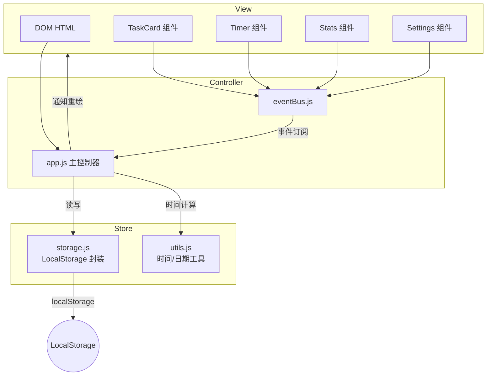
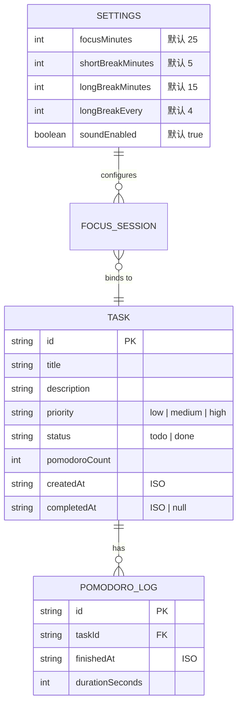

# Architecture Spine — FocusFlow

## Design Paradigm

**分层 + 观察者模式（EventEmitter）**

自上而下三层：
1. **View Layer**（HTML + DOM 渲染）— 纯展示，监听事件后 emit 消息
2. **Controller Layer**（`app.js` + 模块）— 编排业务逻辑，协调状态变化
3. **Store Layer**（`storage.js`）— LocalStorage 读写，数据唯一入口

跨层通信通过一个极简的 EventBus 完成：View emit → Controller 监听 → Store 更新 → Controller 通知 View 重绘。



## Invariants & Rules

### AD-1 — LocalStorage 是唯一持久化入口

- **Binds:** 全部数据读写
- **Prevents:** 多处直接调用 `localStorage.setItem` 导致 key 名不一致、保存时机不一致
- **Rule:** 所有持久化必须经过 `storage.js` 模块暴露的 API，key 名统一在文件顶部常量区声明

### AD-2 — 状态变更必须通过事件总线触发重绘

- **Binds:** 任务列表、计时器、统计面板
- **Prevents:** 直接操作 DOM 导致的视图与数据不同步
- **Rule:** 任何 Store 层数据变更后，Controller 必须 emit `data:changed` 事件；View 层只响应事件、不直接操作 Store

### AD-3 — 计时逻辑必须用 setInterval + 每秒刷新

- **Binds:** 番茄钟倒计时
- **Prevents:** 使用 `setTimeout` 链式调用导致浏览器后台标签页被节流后时间漂移
- **Rule:** 使用单个 `setInterval(fn, 1000)` 驱动计时，每次 tick 递减秒数并同步更新 DOM；暂停时清除 interval，恢复时重建

### AD-4 — 番茄数仅在完整结束时累加

- **Binds:** FR-12 番茄数回写
- **Prevents:** 暂停 / 跳过 / 中途放弃时误加番茄数
- **Rule:** 只有 `sessionState` 从 `focusing` 自然归零（非手动跳过）时，才触发 `pomodoroCount + 1`

### AD-5 — 计时模块与任务模块解耦

- **Binds:** FR-11, FR-12 联动逻辑
- **Prevents:** Timer 直接依赖 Task 数据结构导致耦合
- **Rule:** Timer 模块只维护当前 `sessionState` 和剩余秒数；"是否关联任务、关联哪个任务"由 Controller 在联动层负责

## Consistency Conventions

| Concern | Convention |
| --- | --- |
| 命名（entity、文件、事件） | 文件名 kebab-case（如 `event-bus.js`）；事件名 `module:action` 形如 `task:created`、`timer:finished`、`data:changed` |
| 数据格式（ID、日期） | 任务 ID 使用 `Date.now() + Math.random().toString(36).slice(2,7)` 生成；日期统一用 ISO 字符串（`new Date().toISOString()`） |
| 状态结构 | 所有运行时状态放在 `app.js` 的单一 `state` 对象中；持久化状态通过 Store 层加载 |
| 错误处理 | v1 规模下，数据校验失败时 silent fail + console.warn，不做复杂错误恢复 |

## Stack

| Name | Version |
| --- | --- |
| HTML5 | — |
| CSS3 (纯 CSS，无框架) | — |
| JavaScript ES6+（原生，无框架） | — |
| Web Audio API（提示音合成） | — |
| LocalStorage | Web Standard |

## Structural Seed

```
src/
├── index.html              # 单页 HTML 骨架，含四个区域挂载点
├── css/
│   └── style.css           # 全部样式（单文件，v1 无拆分）
├── js/
│   ├── app.js              # 主控制器：初始化、事件编排、state 对象
│   ├── event-bus.js        # 极简发布/订阅，提供 on/emit/off
│   ├── storage.js          # LocalStorage 读写封装，key 常量集中声明
│   ├── utils.js            # 时间格式化、日期比较、提示音生成等工具函数
│   ├── task-manager.js     # 任务 CRUD 逻辑（不直接操作 DOM）
│   ├── timer.js            # 番茄钟计时引擎（setInterval 驱动）
│   ├── stats.js            # 统计数据聚合与计算
│   └── settings.js         # 设置面板读写与默认值
└── assets/                 # （预留）图标、自定义字体等
```

## Core Entity ERD



## Capability → Architecture Map

| Capability / Area | Lives in | Governed by |
| --- | --- | --- |
| FR-1 ~ FR-5 任务 CRUD | `js/task-manager.js` + `app.js` | AD-2, AD-5 |
| FR-6 ~ FR-10 番茄钟计时 | `js/timer.js` + `app.js` | AD-2, AD-3, AD-4, AD-5 |
| FR-11 ~ FR-12 联动 | `app.js` 中联动层 | AD-4, AD-5 |
| FR-13 ~ FR-15 统计 | `js/stats.js` + `app.js` | AD-2 |
| FR-16 ~ FR-19 设置 | `js/settings.js` + `storage.js` | AD-1 |
| FR-20 ~ FR-21 持久化 | `js/storage.js` | AD-1 |

## Deferred

- **数据导出（CSV/JSON）** → v2，不在此 spine 范围
- **深色模式** → v2，需要 CSS 变量扩展
- **键盘快捷键** → v2，需要在 event-bus 上新增 global key handler
- **Service Worker / PWA** → v3，需要引入构建流程
